# ProHub Collaborative Document Review V1
## Technical Implementation Blueprint for Antigravity

**Document type:** Build specification  
**Target implementation agent:** Antigravity  
**Primary stack:** Streamlit + Supabase + PostgreSQL + Supabase Storage + custom HTML/JavaScript components  
**Primary goal:** Add collaborative document upload, viewing, comments, annotations, file locking, user groups, notifications, and graphical task assignment to the existing ProHub application at minimum practical cost.

---

# 1. Executive Summary

This specification defines the first major collaborative-document-management expansion of ProHub.

The implementation must build the following complete user loop:

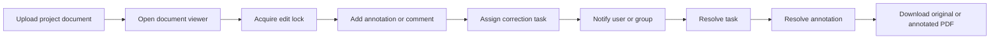

The system must support:

1. Uploading documents into a project.
2. Viewing PDFs and images inside ProHub.
3. Adding persistent comments and page-positioned annotations.
4. Downloading original documents.
5. Generating annotated PDF downloads.
6. Preventing conflicting edits through lease-based locks.
7. Creating project-specific user groups.
8. Sending in-app notifications to users and groups.
9. Creating and graphically assigning tasks.
10. Linking tasks to documents, annotations, and comments.
11. Keeping a complete audit trail.
12. Maintaining low operating cost.
13. Preserving the current ProHub Excel/DCI functionality.

This is not a complete enterprise DMS. It is a focused collaborative review layer.

---

# 2. Scope

## 2.1 In scope

### Document management

- Project-level file upload.
- PDF upload.
- PNG upload.
- JPG/JPEG upload.
- File metadata.
- Private Supabase Storage.
- Signed download URLs.
- Signed viewer URLs.
- Document versions.
- Original download.
- Current-version indicator.
- File hash duplicate detection.
- Maximum upload-size enforcement.

### Viewer

- PDF viewer.
- Image viewer.
- Page navigation.
- Zoom.
- Fit width.
- Fit page.
- Page count.
- Loading state.
- Error state.
- Read-only mode.
- Annotation mode.

### Annotation and comments

- Comment pins.
- Rectangle markup.
- Highlight markup.
- Freehand markup.
- Text comments.
- Replies.
- Mention users.
- Resolve annotation.
- Reopen annotation.
- Edit own annotation.
- Delete own annotation using soft delete.
- Filter annotations.
- Annotation sidebar.
- Audit events.
- Normalized coordinates.
- Annotated PDF generation.

### Locking and concurrency

- Lease-based document edit locks.
- Lock heartbeat.
- Lock expiration.
- Lock takeover after expiration.
- Admin lock release.
- Read-only viewer when locked by another user.
- Optimistic concurrency checks.
- Clear lock-owner display.

### Groups and notifications

- Project-specific groups.
- Add/remove members.
- Searchable user picker.
- Notification center.
- Read/unread state.
- User mentions.
- User notification preferences.
- Group targeting.
- Task-assignment notification.
- Annotation-mention notification.
- Due-date reminder.
- Overdue notification.

### Tasks

- Task creation.
- Task editing.
- Task deletion through soft delete.
- Task status.
- Priority.
- Due date.
- Primary assignee.
- Additional assignees.
- Group assignment.
- Linked project document.
- Linked annotation.
- Linked comment.
- Kanban board.
- Drag-and-drop status movement.
- Graphical person-to-task assignment.
- Activity history.
- Task notifications.

---

## 2.2 Out of scope for V1

The following must not be implemented in this phase:

- Real-time simultaneous collaborative drawing.
- Live user cursors.
- Microsoft Word annotation.
- Excel annotation.
- DWG rendering.
- OCR.
- AI extraction.
- Digital signatures.
- WhatsApp messaging.
- SMS.
- Configurable BPMN workflow builder.
- Engineering drawing comparison.
- Offline editing.
- Audio/video review comments.
- Native mobile application.
- Full-text document-content search.
- Electronic seals.
- Legal e-signature compliance.
- External public sharing.

These can be revisited after the V1 review loop is stable.

---

# 3. Existing-System Constraints

The current ProHub application already contains:

- Streamlit-based user interface.
- Supabase database integration.
- Project creation.
- Project selection.
- DCI workbook imports.
- Template discovery.
- Supabase Storage usage.
- Documents table.
- Document history.
- Formula-preserving Excel export.
- Revision history.
- Project analytics.
- Document timeline.
- Dashboard-managed document fields.

The new implementation must not break:

- Existing DCI imports.
- Existing project records.
- Existing document rows.
- Existing Excel exports.
- Existing revision updates.
- Existing analytics.
- Existing audit history.
- Existing Supabase migrations.
- Existing Streamlit deployment.

The new feature set must be added as a separate domain layer.

---

# 4. Architectural Direction

## 4.1 Recommended architecture

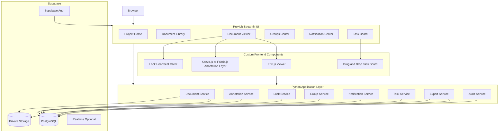

---

## 4.2 Architectural rule

The Streamlit page layer must not directly contain complex database logic.

Use the following split:

```text
UI page
  ↓
service
  ↓
repository
  ↓
Supabase
```

Example:

```text
viewer.py
  ↓
AnnotationService.create_annotation()
  ↓
AnnotationRepository.insert()
  ↓
document_annotations table
```

---

# 5. Target Repository Structure

```text
prohub/
├── app.py
├── config/
│   ├── settings.py
│   ├── constants.py
│   └── feature_flags.py
├── pages/
│   ├── project_home.py
│   ├── document_library.py
│   ├── document_viewer.py
│   ├── groups.py
│   ├── notifications.py
│   └── task_board.py
├── components/
│   ├── pdf_viewer/
│   │   ├── __init__.py
│   │   ├── component.py
│   │   ├── frontend/
│   │   │   ├── index.html
│   │   │   ├── viewer.js
│   │   │   ├── annotations.js
│   │   │   ├── heartbeat.js
│   │   │   └── styles.css
│   ├── image_viewer/
│   │   ├── component.py
│   │   └── frontend/
│   ├── annotation_toolbar/
│   ├── user_picker/
│   ├── notification_bell/
│   └── task_board/
│       ├── component.py
│       └── frontend/
├── services/
│   ├── document_service.py
│   ├── annotation_service.py
│   ├── lock_service.py
│   ├── group_service.py
│   ├── notification_service.py
│   ├── task_service.py
│   ├── export_service.py
│   └── audit_service.py
├── repositories/
│   ├── document_repository.py
│   ├── annotation_repository.py
│   ├── lock_repository.py
│   ├── group_repository.py
│   ├── notification_repository.py
│   ├── task_repository.py
│   └── audit_repository.py
├── domain/
│   ├── documents.py
│   ├── annotations.py
│   ├── locks.py
│   ├── groups.py
│   ├── notifications.py
│   └── tasks.py
├── security/
│   ├── permissions.py
│   ├── rls_helpers.py
│   └── signed_urls.py
├── exports/
│   ├── annotated_pdf.py
│   ├── annotation_summary.py
│   └── original_file.py
├── migrations/
│   ├── 001_document_files.sql
│   ├── 002_annotations.sql
│   ├── 003_document_locks.sql
│   ├── 004_groups.sql
│   ├── 005_notifications.sql
│   ├── 006_tasks.sql
│   ├── 007_audit_events.sql
│   └── 008_rls_policies.sql
├── tests/
│   ├── unit/
│   ├── integration/
│   ├── security/
│   ├── concurrency/
│   └── end_to_end/
└── dashboard_legacy/
    └── existing_dashboard_modules/
```

---

# 6. Domain Model

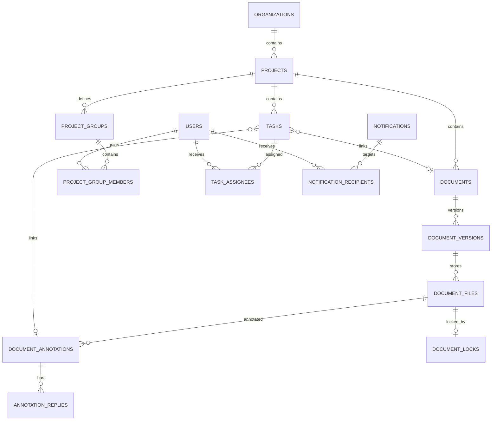

---

# 7. Database Specification

## 7.1 `document_versions`

Purpose:

- Represent immutable logical versions of one project document.
- Allow multiple uploaded files over time.
- Preserve revision history independently from DCI revision columns.

```sql
create table if not exists document_versions (
    id uuid primary key default gen_random_uuid(),
    project_id uuid not null references projects(id) on delete cascade,
    document_id uuid not null references documents(id) on delete cascade,
    version_number integer not null,
    revision_label text,
    version_status text not null default 'active',
    created_by uuid,
    created_at timestamptz not null default now(),
    is_current boolean not null default false,
    notes text,
    unique(document_id, version_number)
);
```

Recommended statuses:

```text
active
superseded
archived
rejected
```

Business rules:

- Exactly one current version per document.
- Older versions remain immutable.
- Annotation coordinates attach to one exact file/version.
- Uploading a new version does not mutate an old version.
- A new version can copy unresolved comments only through explicit user action.

---

## 7.2 `document_files`

```sql
create table if not exists document_files (
    id uuid primary key default gen_random_uuid(),
    project_id uuid not null references projects(id) on delete cascade,
    document_id uuid not null references documents(id) on delete cascade,
    version_id uuid not null references document_versions(id) on delete cascade,
    storage_bucket text not null default 'project-documents',
    storage_path text not null,
    original_filename text not null,
    display_filename text not null,
    mime_type text not null,
    file_extension text,
    size_bytes bigint not null,
    sha256_hash text not null,
    page_count integer,
    image_width integer,
    image_height integer,
    uploaded_by uuid,
    uploaded_at timestamptz not null default now(),
    is_current boolean not null default true,
    is_deleted boolean not null default false,
    deleted_at timestamptz,
    metadata jsonb not null default '{}'::jsonb,
    unique(storage_bucket, storage_path)
);
```

Indexes:

```sql
create index idx_document_files_project
on document_files(project_id);

create index idx_document_files_document
on document_files(document_id);

create index idx_document_files_version
on document_files(version_id);

create index idx_document_files_hash
on document_files(project_id, sha256_hash);
```

---

## 7.3 `document_annotations`

```sql
create table if not exists document_annotations (
    id uuid primary key default gen_random_uuid(),
    project_id uuid not null references projects(id) on delete cascade,
    document_id uuid not null references documents(id) on delete cascade,
    version_id uuid not null references document_versions(id) on delete cascade,
    document_file_id uuid not null references document_files(id) on delete cascade,

    page_number integer not null check (page_number >= 1),

    annotation_type text not null,
    geometry jsonb not null,
    style jsonb not null default '{}'::jsonb,
    comment_text text,

    status text not null default 'open',
    severity text not null default 'normal',

    created_by uuid not null,
    created_at timestamptz not null default now(),
    updated_by uuid,
    updated_at timestamptz not null default now(),

    resolved_by uuid,
    resolved_at timestamptz,
    resolution_note text,

    row_version integer not null default 1,

    is_deleted boolean not null default false,
    deleted_by uuid,
    deleted_at timestamptz
);
```

Allowed annotation types:

```text
pin
rectangle
highlight
freehand
text
```

Allowed statuses:

```text
open
in_review
resolved
reopened
rejected
```

Allowed severity:

```text
low
normal
high
critical
```

---

## 7.4 Annotation geometry format

### Pin

```json
{
  "x": 0.425,
  "y": 0.612
}
```

### Rectangle

```json
{
  "x": 0.12,
  "y": 0.18,
  "width": 0.22,
  "height": 0.09
}
```

### Highlight

```json
{
  "x": 0.18,
  "y": 0.41,
  "width": 0.36,
  "height": 0.03
}
```

### Freehand

```json
{
  "points": [
    {"x": 0.11, "y": 0.20},
    {"x": 0.12, "y": 0.21},
    {"x": 0.14, "y": 0.25}
  ]
}
```

### Text

```json
{
  "x": 0.30,
  "y": 0.40,
  "width": 0.25,
  "height": 0.06
}
```

Coordinates must be normalized from 0 to 1.

Never store raw screen pixels.

---

## 7.5 Annotation style format

```json
{
  "stroke": "#e53935",
  "fill": "rgba(229,57,53,0.15)",
  "stroke_width": 2,
  "opacity": 1,
  "font_size": 14
}
```

The application must validate style values.

Do not trust arbitrary CSS from the browser.

---

## 7.6 `annotation_replies`

```sql
create table if not exists annotation_replies (
    id uuid primary key default gen_random_uuid(),
    annotation_id uuid not null references document_annotations(id) on delete cascade,
    project_id uuid not null references projects(id) on delete cascade,
    reply_text text not null,
    created_by uuid not null,
    created_at timestamptz not null default now(),
    updated_at timestamptz,
    is_deleted boolean not null default false,
    deleted_at timestamptz
);
```

---

## 7.7 `annotation_mentions`

```sql
create table if not exists annotation_mentions (
    id uuid primary key default gen_random_uuid(),
    annotation_id uuid references document_annotations(id) on delete cascade,
    reply_id uuid references annotation_replies(id) on delete cascade,
    mentioned_user_id uuid not null,
    mentioned_by uuid not null,
    created_at timestamptz not null default now(),
    check (
        annotation_id is not null
        or reply_id is not null
    )
);
```

---

## 7.8 `document_locks`

```sql
create table if not exists document_locks (
    id uuid primary key default gen_random_uuid(),
    project_id uuid not null references projects(id) on delete cascade,
    document_id uuid not null references documents(id) on delete cascade,
    version_id uuid not null references document_versions(id) on delete cascade,
    document_file_id uuid not null references document_files(id) on delete cascade,

    locked_by uuid not null,
    lock_token uuid not null default gen_random_uuid(),

    locked_at timestamptz not null default now(),
    heartbeat_at timestamptz not null default now(),
    expires_at timestamptz not null,

    released_at timestamptz,
    released_by uuid,
    release_reason text,

    is_active boolean not null default true
);
```

Partial unique index:

```sql
create unique index uq_active_document_lock
on document_locks(document_file_id)
where is_active = true;
```

Lock defaults:

```text
lease duration: 120 seconds
heartbeat interval: 45 seconds
grace period: 15 seconds
```

---

## 7.9 Lock acquisition transaction

Lock acquisition must happen through a PostgreSQL function.

Pseudo-SQL:

```sql
create or replace function acquire_document_lock(
    p_document_file_id uuid,
    p_user_id uuid,
    p_lease_seconds integer default 120
)
returns jsonb
language plpgsql
security definer
as $$
declare
    v_lock document_locks;
begin
    update document_locks
    set
        is_active = false,
        released_at = now(),
        release_reason = 'expired'
    where document_file_id = p_document_file_id
      and is_active = true
      and expires_at <= now();

    select *
    into v_lock
    from document_locks
    where document_file_id = p_document_file_id
      and is_active = true
    for update;

    if found then
        if v_lock.locked_by = p_user_id then
            update document_locks
            set
                heartbeat_at = now(),
                expires_at = now() + make_interval(secs => p_lease_seconds)
            where id = v_lock.id
            returning * into v_lock;

            return jsonb_build_object(
                'acquired', true,
                'lock_id', v_lock.id,
                'lock_token', v_lock.lock_token,
                'owner', v_lock.locked_by,
                'expires_at', v_lock.expires_at
            );
        end if;

        return jsonb_build_object(
            'acquired', false,
            'owner', v_lock.locked_by,
            'expires_at', v_lock.expires_at
        );
    end if;

    insert into document_locks (
        project_id,
        document_id,
        version_id,
        document_file_id,
        locked_by,
        expires_at
    )
    select
        project_id,
        document_id,
        version_id,
        id,
        p_user_id,
        now() + make_interval(secs => p_lease_seconds)
    from document_files
    where id = p_document_file_id
    returning * into v_lock;

    return jsonb_build_object(
        'acquired', true,
        'lock_id', v_lock.id,
        'lock_token', v_lock.lock_token,
        'owner', v_lock.locked_by,
        'expires_at', v_lock.expires_at
    );
end;
$$;
```

---

## 7.10 `project_groups`

```sql
create table if not exists project_groups (
    id uuid primary key default gen_random_uuid(),
    project_id uuid not null references projects(id) on delete cascade,
    group_name text not null,
    description text,
    group_type text not null default 'custom',
    created_by uuid not null,
    created_at timestamptz not null default now(),
    updated_at timestamptz not null default now(),
    is_active boolean not null default true,
    unique(project_id, group_name)
);
```

Recommended group types:

```text
custom
discipline
review_team
vendor
client
management
```

---

## 7.11 `project_group_members`

```sql
create table if not exists project_group_members (
    id uuid primary key default gen_random_uuid(),
    project_id uuid not null references projects(id) on delete cascade,
    group_id uuid not null references project_groups(id) on delete cascade,
    user_id uuid not null,
    member_role text,
    added_by uuid not null,
    added_at timestamptz not null default now(),
    is_active boolean not null default true,
    unique(group_id, user_id)
);
```

---

## 7.12 `notifications`

```sql
create table if not exists notifications (
    id uuid primary key default gen_random_uuid(),
    project_id uuid references projects(id) on delete cascade,

    notification_type text not null,
    title text not null,
    message text not null,

    entity_type text,
    entity_id uuid,
    action_url text,

    priority text not null default 'normal',

    created_by uuid,
    created_at timestamptz not null default now(),

    deduplication_key text,
    metadata jsonb not null default '{}'::jsonb
);
```

---

## 7.13 `notification_recipients`

```sql
create table if not exists notification_recipients (
    id uuid primary key default gen_random_uuid(),
    notification_id uuid not null references notifications(id) on delete cascade,
    user_id uuid not null,

    in_app_status text not null default 'unread',
    read_at timestamptz,

    email_requested boolean not null default false,
    email_status text not null default 'not_requested',
    email_sent_at timestamptz,
    email_failure_reason text,

    created_at timestamptz not null default now(),

    unique(notification_id, user_id)
);
```

---

## 7.14 `user_notification_preferences`

```sql
create table if not exists user_notification_preferences (
    id uuid primary key default gen_random_uuid(),
    user_id uuid not null,
    project_id uuid references projects(id) on delete cascade,
    event_type text not null,
    in_app_enabled boolean not null default true,
    email_enabled boolean not null default false,
    digest_enabled boolean not null default false,
    updated_at timestamptz not null default now(),
    unique(user_id, project_id, event_type)
);
```

---

## 7.15 `tasks`

```sql
create table if not exists tasks (
    id uuid primary key default gen_random_uuid(),
    project_id uuid not null references projects(id) on delete cascade,

    title text not null,
    description text,

    task_type text not null default 'general',
    status text not null default 'unassigned',
    priority text not null default 'normal',

    start_date date,
    due_date date,
    completed_at timestamptz,

    linked_entity_type text,
    linked_entity_id uuid,

    document_id uuid references documents(id) on delete set null,
    version_id uuid references document_versions(id) on delete set null,
    annotation_id uuid references document_annotations(id) on delete set null,

    created_by uuid not null,
    created_at timestamptz not null default now(),
    updated_by uuid,
    updated_at timestamptz not null default now(),

    row_version integer not null default 1,

    is_deleted boolean not null default false,
    deleted_at timestamptz
);
```

Allowed statuses:

```text
unassigned
assigned
in_progress
blocked
in_review
completed
cancelled
```

Allowed priorities:

```text
low
normal
high
urgent
```

---

## 7.16 `task_assignees`

```sql
create table if not exists task_assignees (
    id uuid primary key default gen_random_uuid(),
    task_id uuid not null references tasks(id) on delete cascade,
    user_id uuid,
    group_id uuid references project_groups(id) on delete cascade,

    assignment_type text not null default 'user',
    is_primary boolean not null default false,

    assigned_by uuid not null,
    assigned_at timestamptz not null default now(),
    removed_at timestamptz,

    check (
        (assignment_type = 'user' and user_id is not null and group_id is null)
        or
        (assignment_type = 'group' and group_id is not null and user_id is null)
    )
);
```

---

## 7.17 `task_activity`

```sql
create table if not exists task_activity (
    id uuid primary key default gen_random_uuid(),
    task_id uuid not null references tasks(id) on delete cascade,
    project_id uuid not null references projects(id) on delete cascade,

    activity_type text not null,
    field_name text,
    old_value text,
    new_value text,
    message text,

    performed_by uuid not null,
    performed_at timestamptz not null default now(),
    metadata jsonb not null default '{}'::jsonb
);
```

---

## 7.18 `collaboration_audit_events`

```sql
create table if not exists collaboration_audit_events (
    id uuid primary key default gen_random_uuid(),
    project_id uuid not null references projects(id) on delete cascade,

    entity_type text not null,
    entity_id uuid not null,

    action text not null,
    actor_user_id uuid,
    actor_display_name text,

    before_state jsonb,
    after_state jsonb,
    metadata jsonb not null default '{}'::jsonb,

    created_at timestamptz not null default now()
);
```

---

# 8. Storage Design

## 8.1 Bucket

Create one private bucket:

```text
project-documents
```

The bucket must not be public.

---

## 8.2 Storage path convention

```text
organizations/{organization_id}/
projects/{project_id}/
documents/{document_id}/
versions/{version_id}/
original/{safe_filename}
```

Example:

```text
organizations/org-123/projects/proj-55/documents/doc-88/versions/ver-3/original/piping-layout-rev2.pdf
```

Optional generated assets:

```text
organizations/{org_id}/projects/{project_id}/documents/{document_id}/versions/{version_id}/previews/page-1.webp
organizations/{org_id}/projects/{project_id}/documents/{document_id}/versions/{version_id}/thumbnails/thumb.webp
```

Do not permanently store every annotated export.

Generate annotated export on request.

---

## 8.3 Upload validation

Before upload:

1. Validate extension.
2. Validate MIME type.
3. Validate file signature.
4. Validate size.
5. Calculate SHA-256.
6. Check duplicate hash in same project.
7. Sanitize filename.
8. Reject executable or archive content.
9. Ensure selected project exists.
10. Ensure current user has upload permission.

Supported MIME types:

```text
application/pdf
image/png
image/jpeg
```

Suggested initial file-size limit:

```text
25 MB per file
```

Make the limit configurable.

---

## 8.4 Duplicate policy

If duplicate hash exists:

```text
This exact file already exists in this project.

Existing document: P-101
Uploaded: 14 July 2026
Version: 2

[Open existing] [Upload as separate copy]
```

Default action:

```text
Do not upload duplicate automatically.
```

---

## 8.5 Signed URLs

Signed URL duration:

```text
Viewer URL: 10 minutes
Download URL: 5 minutes
```

The viewer should refresh the URL if it expires while the page remains open.

Never store signed URLs in the database.

---

# 9. Permissions

## 9.1 Minimum roles

```text
admin
project_admin
document_controller
editor
reviewer
viewer
```

---

## 9.2 Permission matrix

| Action | Admin | Project Admin | Doc Controller | Editor | Reviewer | Viewer |
|---|---:|---:|---:|---:|---:|---:|
| Upload document | Yes | Yes | Yes | Optional | No | No |
| View document | Yes | Yes | Yes | Yes | Yes | Yes |
| Download original | Yes | Yes | Yes | Yes | Yes | Configurable |
| Add annotation | Yes | Yes | Yes | Yes | Yes | No |
| Resolve annotation | Yes | Yes | Yes | Yes | Yes | No |
| Delete own annotation | Yes | Yes | Yes | Yes | Yes | No |
| Delete others' annotation | Yes | Yes | Optional | No | No | No |
| Release lock | Yes | Yes | Optional | No | No | No |
| Create group | Yes | Yes | Yes | No | No | No |
| Assign task | Yes | Yes | Yes | Yes | Optional | No |
| Change task status | Yes | Yes | Yes | Yes | Yes | No |
| Manage notification prefs | Own | Own | Own | Own | Own | Own |

---

## 9.3 Security rules

- Service-role key must never be exposed to browser JavaScript.
- All write operations must pass through server-side Python or secure RPC.
- Signed URLs must be generated server-side.
- Row Level Security must be enabled for all collaboration tables.
- Every query must be project scoped.
- Every mutation must verify project membership.
- Annotation deletion must be soft deletion.
- Task deletion must be soft deletion.
- Lock token must be required for lock renewal and release.
- An expired lock must never block new acquisition.
- Viewer role must not gain annotation APIs merely by manipulating browser payloads.

---

# 10. Document Upload Flow

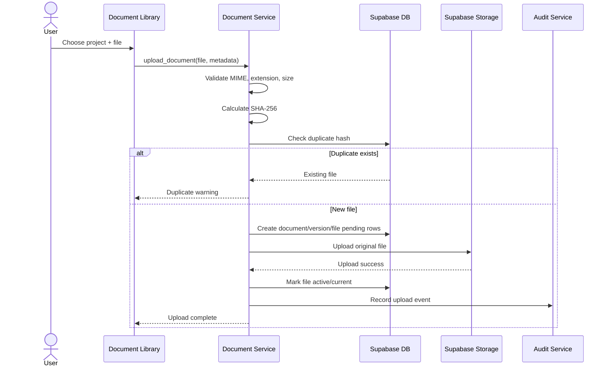

---

# 11. Document Viewer Specification

## 11.1 Layout

```text
┌────────────────────────────────────────────────────────────────────┐
│ Breadcrumbs: Project > Documents > P-101 > Revision 2             │
├────────────────────────────────────────────────────────────────────┤
│ [Back] [Download original] [Download annotated] [Version ▼]       │
├───────────────┬───────────────────────────────────────┬────────────┤
│ Pages         │ Viewer                                │ Comments   │
│               │                                       │            │
│ Page 1        │       rendered PDF page               │ Filters    │
│ Page 2        │       + annotation overlay            │            │
│ Page 3        │                                       │ Thread 1   │
│               │                                       │ Thread 2   │
│               │                                       │ Thread 3   │
├───────────────┴───────────────────────────────────────┴────────────┤
│ Lock: Editable by you | Autosave: saved | Zoom: 100%               │
└────────────────────────────────────────────────────────────────────┘
```

---

## 11.2 Viewer states

```text
loading
loaded_read_only
loaded_editable
locked_by_other
unsupported_file
failed_to_load
signed_url_expired
no_permission
```

---

## 11.3 Viewer toolbar

V1 toolbar:

```text
Select
Comment Pin
Rectangle
Highlight
Freehand
Undo
Redo
Delete Selected
Resolve
Zoom In
Zoom Out
Fit Width
Fit Page
```

---

## 11.4 File type behavior

### PDF

- Render using PDF.js.
- One canvas per visible page.
- Lazy-render pages.
- Overlay annotation canvas on each rendered page.
- Maintain zoom-safe normalized coordinates.

### Image

- Render image.
- Single annotation layer.
- Treat as page 1.

### Unsupported

Show:

```text
Preview is not supported for this file type.
You can still download the original file.
```

---

# 12. Annotation Lifecycle

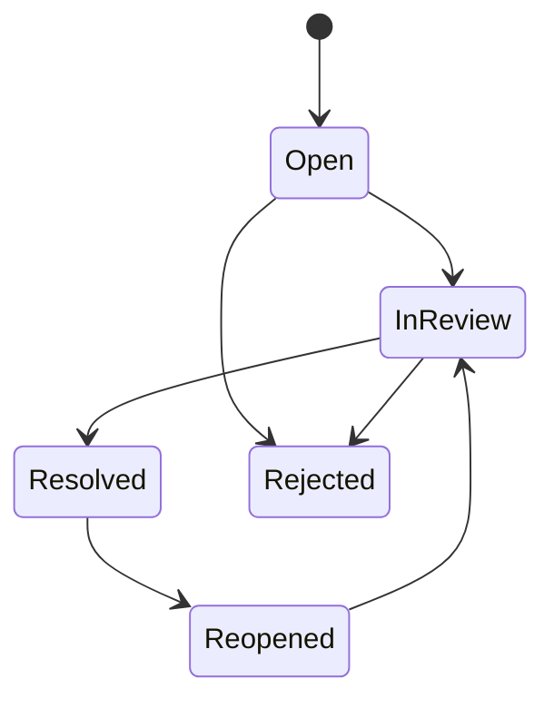

---

## 12.1 Annotation creation flow

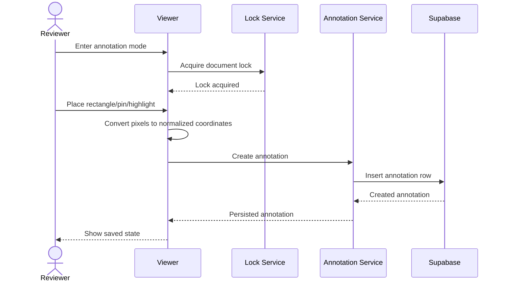

---

## 12.2 Autosave

For new annotation:

- Save after geometry completion.
- Save comment text after 800 ms debounce.
- Display `Saving...`.
- Display `Saved`.
- On failure display `Retry`.

Do not silently discard unsaved annotations.

---

## 12.3 Optimistic concurrency

Every annotation includes `row_version`.

Update request:

```json
{
  "annotation_id": "uuid",
  "expected_row_version": 4,
  "changes": {
    "comment_text": "Updated comment"
  }
}
```

Database update:

```sql
update document_annotations
set
    comment_text = :comment_text,
    row_version = row_version + 1,
    updated_at = now()
where id = :annotation_id
  and row_version = :expected_row_version;
```

If zero rows updated:

```text
Conflict detected.
This annotation was changed after you opened it.
```

Options:

```text
Reload latest
Copy my text
Cancel
```

---

# 13. Locking Specification

## 13.1 Why lease locks

A permanent Boolean lock is unsafe.

Failure example:

```text
User opens file
    ↓
is_locked = true
    ↓
Browser crashes
    ↓
File remains locked forever
```

Lease lock behavior:

```text
User opens edit mode
    ↓
Lock valid for 120 seconds
    ↓
Heartbeat renews every 45 seconds
    ↓
Browser closes
    ↓
Heartbeat stops
    ↓
Lock automatically expires
```

---

## 13.2 Lock flow

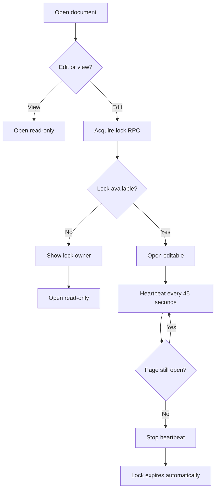

---

## 13.3 Lock banner

Editable:

```text
🟢 Editing enabled
You currently hold the document lock.
Lock renews automatically.
```

Locked by other:

```text
🔒 Read-only mode
This document is currently being annotated by Rahul Sharma.
Lock expires at 10:42 PM unless renewed.
```

Expired:

```text
⚠ Previous editor's lock expired.
[Take edit control]
```

Admin:

```text
[Force release lock]
```

Force release requires confirmation and audit entry.

---

# 14. Annotated PDF Export

## 14.1 Export types

```text
Original file
Annotated PDF
Annotation summary only
```

---

## 14.2 Annotated PDF generation flow

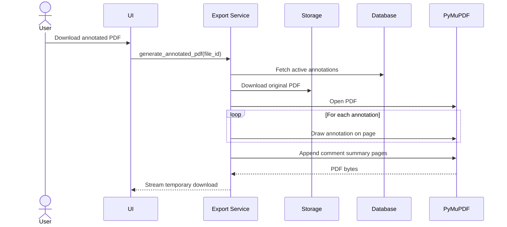

---

## 14.3 Export rules

- Never modify original PDF.
- Use active non-deleted annotations only.
- Optionally include resolved annotations.
- Number annotations.
- Include annotation author.
- Include date.
- Include status.
- Include severity.
- Include comment.
- Include replies in summary.
- Include project and document metadata.
- Include generated timestamp.
- Include generated-by user.
- Do not permanently store export unless explicitly configured.

---

# 15. User Groups

## 15.1 Group management page

```text
┌───────────────────────────────────────────────────────────────┐
│ Project Groups                                                │
├─────────────────────┬─────────────────────────────────────────┤
│ Groups              │ Selected Group                          │
│                     │                                         │
│ Mechanical Review   │ Name: Mechanical Review                 │
│ Electrical Review   │ Description: ...                        │
│ Client Team         │                                         │
│ Vendor A            │ Members                                 │
│                     │ [Search people...]                      │
│ [+ Create Group]    │ Rahul Sharma        [Remove]            │
│                     │ Anita Verma         [Remove]             │
│                     │ [+ Add Members]                          │
└─────────────────────┴─────────────────────────────────────────┘
```

---

## 15.2 Group-member selector

Requirements:

- Search by name.
- Search by email.
- Show role.
- Show project membership.
- Hide already selected members.
- Multi-select.
- Confirm before bulk removal.
- Show member count.
- Prevent duplicate members.
- Allow one user in multiple groups.

---

## 15.3 Group notification expansion

When sending to a group:

```text
group id
    ↓
active group members
    ↓
deduplicate users
    ↓
apply user preferences
    ↓
create notification recipients
```

Do not store only the group ID as notification recipient.

Expand recipients at send time, so the historical recipient list remains accurate.

---

# 16. Notification Center

## 16.1 Notification types

```text
annotation_created
annotation_mentioned
annotation_replied
annotation_resolved
task_assigned
task_reassigned
task_due_soon
task_overdue
task_completed
document_uploaded
document_new_version
lock_force_released
group_member_added
```

---

## 16.2 Notification UI

```text
🔔 7

Today
------------------------------------------------
[Unread] Rahul assigned “Review Rev-2” to you
         10 minutes ago

[Unread] Anita mentioned you in a comment on P-101
         25 minutes ago

Yesterday
------------------------------------------------
Task “Close nozzle comment” is overdue
```

Actions:

```text
Mark as read
Mark all as read
Open linked item
Filter unread
Filter project
Filter type
```

---

## 16.3 Notification deduplication

Use a deduplication key.

Example:

```text
task_due_soon:{task_id}:{user_id}:{date}
```

This prevents repeated reminders from creating duplicates.

---

## 16.4 Email policy

V1 email only for:

- Task assigned.
- User mentioned.
- Task due within 24 hours.
- Task overdue.
- Critical annotation.
- Document approval/return if later connected.

Everything else:

```text
in-app only
```

---

# 17. Task Management

## 17.1 Task creation

Task fields:

```text
Title
Description
Task type
Linked document
Linked version
Linked annotation
Priority
Primary assignee
Additional assignees
Group assignee
Start date
Due date
Status
```

---

## 17.2 Task creation from annotation

From annotation sidebar:

```text
[Create task]
```

Pre-filled:

```text
Title: Resolve annotation #12
Description: Check nozzle orientation
Linked document: P-101
Linked version: Rev-2
Linked annotation: #12
Status: Unassigned
```

---

## 17.3 Kanban board

```text
┌──────────────┬──────────────┬───────────────┬──────────────┐
│ Unassigned   │ Assigned     │ In Progress   │ Completed    │
├──────────────┼──────────────┼───────────────┼──────────────┤
│ Review P-101 │ Close C-12   │ Review M-204  │ Update E-18  │
│ High         │ Rahul        │ Anita         │ Vikram       │
│ Due Jul 18   │ Due Jul 16   │ Due Jul 20    │ Done Jul 14  │
└──────────────┴──────────────┴───────────────┴──────────────┘
```

Card fields:

- Title.
- Linked document number.
- Priority.
- Primary assignee.
- Due date.
- Overdue indicator.
- Annotation count.
- Comment count.

---

## 17.4 Drag-and-drop status update

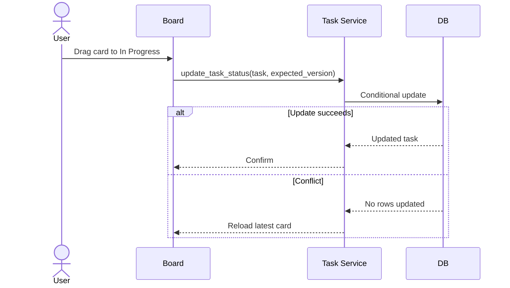

---

## 17.5 Graphical person assignment

Recommended V1:

```text
People tray on left
Task board on right
Drag person chip/avatar onto task
```

Behavior:

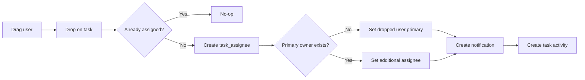

---

## 17.6 Assignment rules

- One primary assignee maximum.
- Multiple secondary assignees allowed.
- Group assignment allowed.
- Group assignment should not automatically duplicate all users into task_assignees unless business requirement requires it.
- Task must show one accountable owner.
- Reassignment creates activity.
- Removing assignee creates activity.
- Assignment notification is deduplicated.
- Self-assignment allowed.
- Viewer role cannot assign.

---

# 18. Service Interfaces

## 18.1 Document service

```python
class DocumentService:
    def upload_document(
        self,
        project_id: str,
        source_file,
        metadata: dict,
        actor_user_id: str,
    ) -> dict:
        ...

    def create_version(
        self,
        document_id: str,
        source_file,
        revision_label: str | None,
        actor_user_id: str,
    ) -> dict:
        ...

    def get_viewer_payload(
        self,
        document_file_id: str,
        actor_user_id: str,
    ) -> dict:
        ...

    def create_download_url(
        self,
        document_file_id: str,
        actor_user_id: str,
    ) -> str:
        ...
```

---

## 18.2 Annotation service

```python
class AnnotationService:
    def list_annotations(
        self,
        document_file_id: str,
        filters: dict,
        actor_user_id: str,
    ) -> list[dict]:
        ...

    def create_annotation(
        self,
        payload: dict,
        lock_token: str,
        actor_user_id: str,
    ) -> dict:
        ...

    def update_annotation(
        self,
        annotation_id: str,
        expected_row_version: int,
        changes: dict,
        lock_token: str,
        actor_user_id: str,
    ) -> dict:
        ...

    def resolve_annotation(
        self,
        annotation_id: str,
        resolution_note: str,
        actor_user_id: str,
    ) -> dict:
        ...
```

---

## 18.3 Lock service

```python
class LockService:
    def acquire(
        self,
        document_file_id: str,
        actor_user_id: str,
    ) -> dict:
        ...

    def heartbeat(
        self,
        lock_id: str,
        lock_token: str,
        actor_user_id: str,
    ) -> dict:
        ...

    def release(
        self,
        lock_id: str,
        lock_token: str,
        actor_user_id: str,
    ) -> None:
        ...

    def force_release(
        self,
        lock_id: str,
        reason: str,
        actor_user_id: str,
    ) -> None:
        ...
```

---

## 18.4 Group service

```python
class GroupService:
    def create_group(...): ...
    def update_group(...): ...
    def list_groups(...): ...
    def add_members(...): ...
    def remove_members(...): ...
    def expand_group_recipients(...): ...
```

---

## 18.5 Notification service

```python
class NotificationService:
    def notify_users(...): ...
    def notify_group(...): ...
    def mark_read(...): ...
    def mark_all_read(...): ...
    def list_notifications(...): ...
    def send_email_if_enabled(...): ...
```

---

## 18.6 Task service

```python
class TaskService:
    def create_task(...): ...
    def update_task(...): ...
    def move_task(...): ...
    def assign_user(...): ...
    def assign_group(...): ...
    def remove_assignee(...): ...
    def list_board(...): ...
    def get_activity(...): ...
```

---

# 19. API/RPC Contract

Even if implemented internally through Streamlit, define stable contracts.

## 19.1 Document endpoints

```text
POST   /projects/{project_id}/documents/upload
POST   /documents/{document_id}/versions
GET    /document-files/{file_id}/viewer
GET    /document-files/{file_id}/download
GET    /document-files/{file_id}/annotated-download
```

---

## 19.2 Annotation endpoints

```text
GET    /document-files/{file_id}/annotations
POST   /document-files/{file_id}/annotations
PATCH  /annotations/{annotation_id}
DELETE /annotations/{annotation_id}
POST   /annotations/{annotation_id}/resolve
POST   /annotations/{annotation_id}/reopen
POST   /annotations/{annotation_id}/replies
```

---

## 19.3 Lock endpoints

```text
POST   /document-files/{file_id}/locks/acquire
POST   /locks/{lock_id}/heartbeat
POST   /locks/{lock_id}/release
POST   /locks/{lock_id}/force-release
```

---

## 19.4 Group endpoints

```text
GET    /projects/{project_id}/groups
POST   /projects/{project_id}/groups
PATCH  /groups/{group_id}
DELETE /groups/{group_id}
POST   /groups/{group_id}/members
DELETE /groups/{group_id}/members/{user_id}
```

---

## 19.5 Notification endpoints

```text
GET    /notifications
POST   /notifications/{id}/read
POST   /notifications/read-all
GET    /notification-preferences
PATCH  /notification-preferences
```

---

## 19.6 Task endpoints

```text
GET    /projects/{project_id}/tasks
POST   /projects/{project_id}/tasks
GET    /tasks/{task_id}
PATCH  /tasks/{task_id}
DELETE /tasks/{task_id}
POST   /tasks/{task_id}/assignees
DELETE /tasks/{task_id}/assignees/{assignment_id}
GET    /tasks/{task_id}/activity
```

---

# 20. UI Navigation

Add to project navigation:

```text
Project Overview
Document Register
Document Library
Document Viewer
Task Board
Groups
Notifications
Import / Export
Administration
```

---

# 21. Sprint Plan

# Sprint 0 — Refactor and Foundations

## Objective

Prepare the current monolithic application for safe feature development.

## Deliverables

- Split page rendering from service logic.
- Create repository structure.
- Add feature flags.
- Add migration runner convention.
- Add centralized permission helper.
- Add centralized current-user helper.
- Add structured logging.
- Add error boundary helper.
- Add environment validation.
- Add test database configuration.

## Technical tasks

- Extract Supabase client.
- Extract project selection.
- Extract user context.
- Extract current import logic without behavior change.
- Add `services/`.
- Add `repositories/`.
- Add `domain/`.
- Add `migrations/`.
- Add `tests/`.
- Add `FEATURE_COLLABORATION_V1`.
- Add `FEATURE_DOCUMENT_VIEWER`.
- Add `FEATURE_TASK_BOARD`.

## Acceptance criteria

- Existing dashboard runs unchanged.
- Existing import works.
- Existing export works.
- Existing analytics work.
- New modules import without circular dependencies.
- No service-role key reaches browser code.

## Main risks

- Breaking Streamlit session state.
- Circular imports.
- Hidden dependencies in the monolith.
- Cache invalidation bugs.

## Mitigation

- Refactor incrementally.
- Preserve old functions temporarily.
- Add compatibility adapter.
- Run smoke test after each extraction.

---

# Sprint 1 — Files and Document Viewing

## Objective

Allow project members to upload, view, and download PDFs and images.

## Deliverables

- Private storage bucket.
- `document_versions`.
- `document_files`.
- Upload page.
- File metadata.
- Duplicate detection.
- PDF viewer.
- Image viewer.
- Version selector.
- Original download.
- Signed URL generation.
- Permission checks.
- Upload audit events.

## UI flow

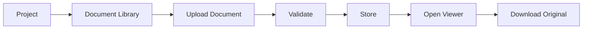

## Detailed tasks

### Database

- Create tables.
- Add indexes.
- Add current-version constraint.
- Add RLS.
- Add audit trigger or service-level audit.

### Storage

- Create private bucket.
- Implement path generator.
- Implement filename sanitizer.
- Implement hash calculator.
- Implement upload rollback.

### Viewer

- Add PDF.js component.
- Add image viewer.
- Add page navigation.
- Add zoom controls.
- Add loading and error states.
- Add signed URL refresh.

### Testing

- Upload valid PDF.
- Upload valid image.
- Reject unsupported file.
- Reject oversized file.
- Reject invalid MIME.
- Duplicate warning.
- Signed URL expiry.
- Viewer permission denial.
- Storage upload failure rollback.

## Acceptance criteria

- User can upload a PDF to a project.
- User can see file metadata.
- User can open PDF inside ProHub.
- User can view image inside ProHub.
- User can download original.
- URL is not public.
- Duplicate file is detected.
- Unauthorized user cannot view or download.

## Major implementation risks

### Risk: Streamlit rerender resets viewer state

Mitigation:

- Keep page/zoom/selection in custom component state.
- Return only meaningful events to Streamlit.
- Avoid rerunning on every mouse move.

### Risk: Large PDF browser memory

Mitigation:

- Lazy-render visible pages.
- Destroy off-screen canvases.
- Limit initial preview size.
- Warn above configurable page threshold.

### Risk: Storage upload succeeds but DB insert fails

Mitigation:

- Create pending DB row first.
- Upload.
- Mark active only after success.
- Delete orphaned object on failure.
- Add cleanup job for stale pending rows.

---

# Sprint 2 — Comments and Annotation Pins

## Objective

Deliver the first stable annotation workflow using comment pins.

## Deliverables

- Annotation tables.
- Reply tables.
- Mention table.
- Pin annotation tool.
- Comments sidebar.
- Persistent normalized coordinates.
- Replies.
- Resolve/reopen.
- Mention users.
- Filter by status and author.
- Annotation audit.
- Basic notification events.

## Annotation pin flow

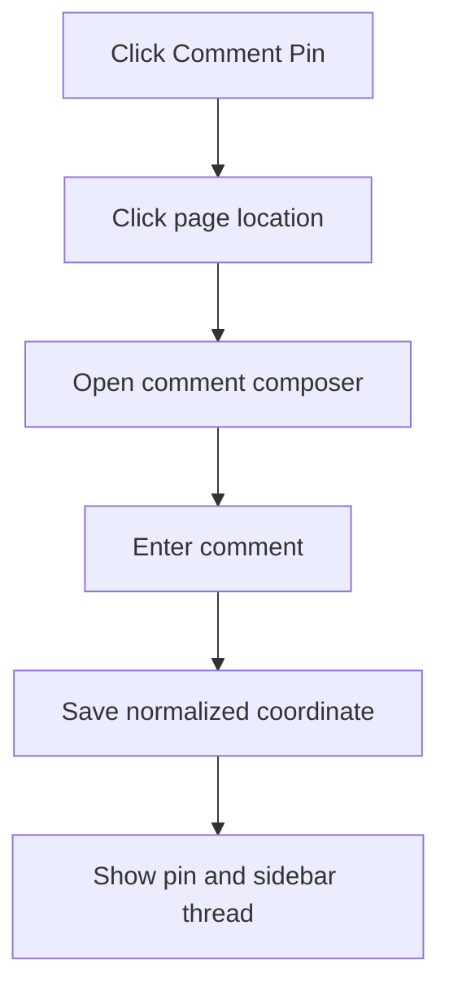

## Detailed tasks

### Frontend

- Pin placement.
- Pin numbering.
- Selected pin state.
- Comments sidebar.
- Thread view.
- Reply composer.
- Resolve/reopen actions.
- Mention autocomplete.

### Backend

- Insert annotation.
- Update annotation.
- Soft delete.
- Insert reply.
- Resolve.
- Reopen.
- Audit.
- Mention parsing.
- Notification creation.

### Testing

- Pin remains after refresh.
- Pin stays aligned after zoom.
- Pin stays aligned at fit width.
- Pin appears on correct page.
- Reply order correct.
- Deleted annotation hidden.
- Resolved annotation filter works.
- Mention recipient receives notification.
- Unauthorized edit rejected.

## Acceptance criteria

- User can click on PDF and create comment pin.
- Pin survives refresh.
- Coordinates remain correct at different zoom.
- Replies work.
- Resolve/reopen works.
- Mentions create notification.
- Audit history records create/update/resolve/delete.

## Major risks

### Risk: coordinate drift

Mitigation:

- Normalize against original page dimensions.
- Include page rotation.
- Test portrait, landscape, and rotated pages.
- Never normalize against browser viewport.

### Risk: comments disappear on rerun

Mitigation:

- Database is source of truth.
- Local optimistic state merges with server response.
- Reload after confirmed save.

### Risk: mention parsing errors

Mitigation:

- Use structured mention IDs.
- Do not infer users only from `@text`.
- Store mention tokens in editor payload.

---

# Sprint 3 — Drawing Annotations and Export

## Objective

Add useful markup tools and downloadable annotated PDFs.

## Deliverables

- Rectangle.
- Highlight.
- Freehand.
- Selection.
- Move/resize.
- Delete selected.
- Undo/redo.
- Annotation styles.
- Annotation filtering.
- Annotated PDF generation.
- Annotation summary pages.
- Original vs annotated download options.

## Detailed tasks

### Canvas

- Shape creation.
- Shape selection.
- Shape transform.
- Z-order.
- Undo stack.
- Redo stack.
- Keyboard delete.
- Escape cancel.
- Touch behavior.

### Export

- Map normalized geometry to PDF coordinates.
- Handle PDF page rotation.
- Draw rectangle.
- Draw highlight.
- Draw freehand.
- Draw pin marker.
- Draw comment number.
- Append summary.
- Stream bytes.
- Never overwrite original.

### Testing

- Export annotations on every supported page size.
- Export rotated pages.
- Freehand scaling.
- Rectangle scaling.
- Highlight transparency.
- Unicode comments.
- Long comments.
- Many annotations.
- Resolved-filter export.
- No annotations case.

## Acceptance criteria

- All four annotation tools work.
- Annotations remain correctly positioned.
- User can edit/delete own markup.
- Annotated PDF visually matches viewer.
- Summary identifies every annotation.
- Original file remains byte-identical.

## Major risks

### Risk: viewer and export coordinate systems differ

Mitigation:

- Define one canonical normalized schema.
- Add conversion utility.
- Add golden-file tests.
- Test MediaBox and CropBox.
- Account for page rotation.

### Risk: freehand JSON becomes large

Mitigation:

- Simplify points client-side.
- Apply Ramer-Douglas-Peucker.
- Limit maximum points.
- Store compressed point arrays if needed.

### Risk: export blocks app

Mitigation:

- Generate on demand.
- Cache briefly by file version + annotation revision hash.
- For V1, synchronous export acceptable below configured file/page limits.
- Add worker later if needed.

---

# Sprint 4 — Locking and Concurrency

## Objective

Prevent conflicting annotation edits without permanently blocking users.

## Deliverables

- Lock table.
- Lock RPC.
- Heartbeat RPC.
- Release RPC.
- Force-release RPC.
- Read-only mode.
- Visible editor identity.
- Lock expiry.
- Optimistic row versions.
- Conflict UI.
- Audit events.

## Detailed tasks

### Database

- Partial unique index.
- Acquire function.
- Heartbeat function.
- Release function.
- Force-release function.
- Expired-lock cleanup.

### Frontend

- Enter edit mode.
- Lock banner.
- Lock owner.
- Heartbeat timer.
- Lost-lock handling.
- Read-only fallback.
- Take-control action after expiry.
- Admin release modal.

### Testing

- Two browsers attempt edit.
- One acquires.
- One is read-only.
- Heartbeat extends.
- Browser closes.
- Lock expires.
- Second browser acquires.
- Admin force release.
- Old client cannot save after loss.
- Row-version conflict detected.

## Acceptance criteria

- Only one editor can modify annotation geometry at a time.
- Multiple viewers can read simultaneously.
- Lock automatically expires.
- Browser crash does not permanently lock file.
- Admin force release is audited.
- Stale save cannot overwrite newer data.

## Major risks

### Risk: Streamlit cannot reliably send heartbeat

Mitigation:

- Heartbeat runs inside browser component.
- Component calls secure backend/RPC endpoint.
- Do not depend on Streamlit rerun timer.

### Risk: clock drift

Mitigation:

- Database time is authoritative.
- Never calculate expiry using client clock.

### Risk: old browser continues editing after lost lock

Mitigation:

- Every mutation requires valid lock token.
- Lock token checked server-side.
- Client changes to read-only on heartbeat failure.

---

# Sprint 5 — Groups and Notification Center

## Objective

Allow project administrators to organize users and target notifications.

## Deliverables

- Group CRUD.
- Member management.
- Searchable user picker.
- Notification table.
- Recipient table.
- Notification bell.
- Read/unread.
- Mark all read.
- Preferences.
- Group notifications.
- Mention notifications.
- Task assignment notifications.
- Due reminders.
- Optional low-volume email integration.

## Detailed tasks

### Group management

- Group list.
- Create/edit group.
- Add members.
- Remove members.
- Member count.
- Group type.
- Permissions.

### Notifications

- Notification factory.
- Recipient expansion.
- Deduplication.
- List query.
- Unread count.
- Read action.
- Preference filtering.

### Email

- Integrate provider only after in-app works.
- Email templates.
- Retry status.
- Failure logging.
- Rate limits.

### Testing

- Duplicate group name rejected.
- Duplicate member rejected.
- Removed member no longer targeted.
- Historical notifications remain.
- Mention deduplicates.
- Read state persists.
- Preference disables email.
- Group send deduplicates overlapping members.

## Acceptance criteria

- Admin can create project group.
- Admin can add/remove users.
- Group can be selected as notification target.
- User sees notification bell count.
- Read/unread persists.
- Mention links directly to annotation.
- Task assignment links directly to task.

## Major risks

### Risk: notification spam

Mitigation:

- Dedup keys.
- User preferences.
- In-app by default.
- Email only for important events.
- Later digest.

### Risk: group changes alter old notification history

Mitigation:

- Expand to concrete recipients at send time.
- Never resolve historical notifications dynamically from current group membership.

---

# Sprint 6 — Tasks and Visual Board

## Objective

Create an actionable graphical task-management layer tied to documents and annotations.

## Deliverables

- Task CRUD.
- Assignee management.
- Primary owner.
- Group assignment.
- Due dates.
- Priorities.
- Kanban board.
- Drag-and-drop status.
- Drag person onto task.
- Linked documents.
- Linked annotations.
- Activity history.
- Assignment notification.
- Due/overdue reminders.
- Task details drawer.

## Detailed tasks

### Task board

- Columns.
- Cards.
- Filters.
- Search.
- Project scope.
- Assignee filter.
- Priority filter.
- Overdue filter.
- Drag status.
- Optimistic board update.
- Rollback on failure.

### Assignment

- People tray.
- Drag user to card.
- Set primary.
- Add secondary.
- Remove.
- Reassign.
- Notify.
- Activity log.

### Links

- Open linked document.
- Focus linked annotation.
- Open comment thread.
- Create task from annotation.
- Resolve annotation from completed task optionally.

### Testing

- Drag between columns.
- Failed update rollback.
- Concurrent task update conflict.
- Multiple assignees.
- One primary owner.
- Group assignment.
- Due reminder.
- Overdue notification.
- Deleted task hidden.
- Linked annotation opens correct page.

## Acceptance criteria

- User can create task.
- User can drag task between statuses.
- User can drag person onto task.
- Assignee receives notification.
- Task opens linked document/annotation.
- Activity history records every meaningful update.
- Conflicts do not silently overwrite.

## Major risks

### Risk: custom component complexity

Mitigation:

- Start with standard Streamlit columns and buttons.
- Add drag-and-drop component only after task APIs stabilize.
- Keep board state server-authoritative.

### Risk: task status and annotation status diverge

Mitigation:

- Do not automatically couple them in V1.
- Offer explicit action:
  `Complete task and resolve annotation`.
- Audit both updates.

---

# 22. End-to-End User Journeys

## 22.1 Reviewer journey

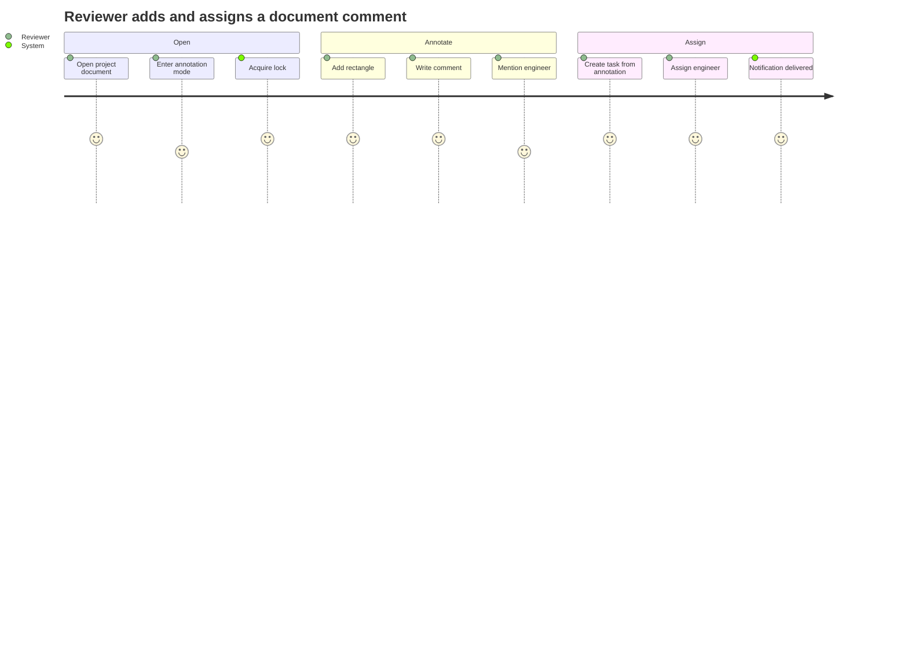

---

## 22.2 Engineer journey

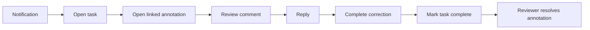

---

# 23. Cost-Control Requirements

## 23.1 Required cost controls

- Supabase free tier first.
- One private storage bucket.
- Signed URLs.
- No permanent annotated exports.
- No OCR.
- No live collaborative cursors.
- PDF/images only.
- 25 MB upload limit.
- File hash duplicate detection.
- Thumbnail generated once.
- Lazy PDF page rendering.
- In-app notifications before email.
- Email only for important events.
- No Redis initially.
- No separate worker initially unless export becomes slow.
- No paid viewer SDK.
- No paid annotation SDK.
- Use PDF.js.
- Use Konva.js or Fabric.js.
- Use PyMuPDF.

---

## 23.2 Approximate initial operating cost

```text
Supabase database: ₹0 initially
Supabase storage: ₹0 initially within allowance
Supabase auth: ₹0 initially
Streamlit hosting: ₹0 initially
PDF.js: ₹0
Konva.js/Fabric.js: ₹0
PyMuPDF: ₹0
In-app notifications: ₹0
Email: ₹0 initially within provider free tier
Domain: optional
```

---

# 24. Error Handling

Every user-facing failure must have:

1. Clear title.
2. Human-readable explanation.
3. Retry action where safe.
4. No raw stack trace.
5. Correlation ID in logs.
6. Audit or error record for important failures.

Examples:

```text
Upload failed
The file could not be stored. No document record was activated.
Please retry.
Error reference: UP-20260715-93K2
```

```text
Edit lock lost
Your edit session expired or was released.
Your unsaved comment text has been copied locally.
Reload the document to continue.
```

---

# 25. Observability

Log:

- Upload started.
- Upload completed.
- Upload failed.
- Viewer opened.
- Signed URL generated.
- Annotation created.
- Annotation updated.
- Annotation conflict.
- Lock acquired.
- Lock denied.
- Lock heartbeat failed.
- Lock force released.
- Notification created.
- Email failed.
- Task assigned.
- Task status changed.
- Annotated export generated.
- Export failed.

Recommended structured fields:

```json
{
  "event": "annotation.created",
  "project_id": "...",
  "document_id": "...",
  "file_id": "...",
  "annotation_id": "...",
  "actor_user_id": "...",
  "request_id": "...",
  "duration_ms": 84
}
```

---

# 26. Test Strategy

## 26.1 Unit tests

- Coordinate normalization.
- Coordinate denormalization.
- Filename sanitization.
- Hash calculation.
- MIME validation.
- Lock expiry calculation.
- Notification dedup key.
- Task transition rules.
- Export coordinate conversion.

## 26.2 Integration tests

- Upload DB + storage.
- Rollback on storage failure.
- Signed URL generation.
- Annotation CRUD.
- Lock RPC.
- Group expansion.
- Notification recipient creation.
- Task assignment.
- Annotated PDF generation.

## 26.3 Security tests

- Cross-project access denied.
- Viewer cannot annotate.
- Reviewer cannot manage groups.
- Invalid lock token rejected.
- Expired lock token rejected.
- Direct storage path access denied.
- Service-role key absent from browser.
- Soft-deleted data excluded.

## 26.4 Concurrency tests

- Two lock attempts.
- Heartbeat race.
- Lock expiry takeover.
- Concurrent annotation update.
- Concurrent task move.
- Force-release while editing.
- Stale client mutation.

## 26.5 End-to-end tests

```text
Upload PDF
Open viewer
Acquire lock
Add pin
Reply
Create task
Assign user
Receive notification
Complete task
Resolve annotation
Download annotated PDF
```

---

# 27. Definition of Done

A sprint is complete only when:

- Database migration exists.
- Migration rollback strategy exists.
- RLS exists.
- Service code exists.
- Repository code exists.
- UI exists.
- Audit event exists.
- Error handling exists.
- Unit tests pass.
- Integration tests pass.
- Existing ProHub features still work.
- Feature flag can disable the feature.
- Documentation is updated.
- No service-role key is exposed.
- No public storage URL is used.
- Acceptance criteria are demonstrated.

---

# 28. Antigravity Build Rules

Antigravity must follow these rules:

1. Do not rewrite the entire existing application.
2. Add changes incrementally.
3. Preserve existing features.
4. Create migrations before depending on new tables.
5. Use feature flags.
6. Keep database access out of UI pages.
7. Use service and repository layers.
8. Keep storage private.
9. Use signed URLs.
10. Use normalized coordinates.
11. Use lease-based locks.
12. Require lock tokens for annotation mutation.
13. Use optimistic concurrency.
14. Soft delete collaboration records.
15. Audit meaningful changes.
16. Do not add paid SDK dependencies.
17. Do not add OCR.
18. Do not add unsupported file annotation.
19. Do not store annotated PDF copies permanently by default.
20. Do not silently swallow errors.
21. Do not expose raw Supabase service credentials.
22. Add tests with each feature.
23. Add indexes for project/document filtering.
24. Ensure every table is project scoped.
25. Keep old Excel/DCI functionality operational.

---

# 29. Recommended Implementation Order

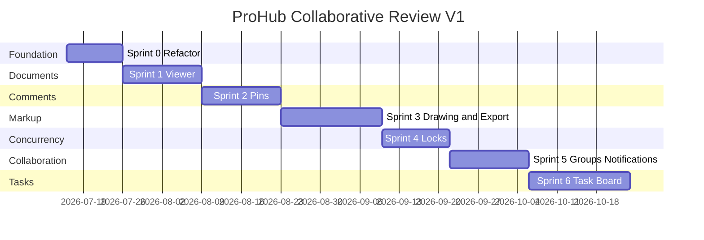

The dates are planning placeholders, not commitments.

---

# 30. Final V1 Product Loop

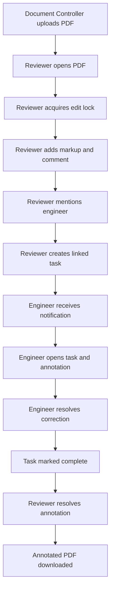

---

# 31. Final Acceptance Scenario

The release is considered successful when this scenario works:

1. Project Admin creates or selects a project.
2. Document Controller uploads a PDF.
3. The PDF is stored privately.
4. Reviewer opens the PDF in ProHub.
5. Reviewer selects annotation mode.
6. System acquires a lease lock.
7. A second reviewer can open the same PDF read-only.
8. First reviewer draws a rectangle.
9. First reviewer adds a comment.
10. First reviewer mentions an engineer.
11. Engineer receives an in-app notification.
12. Reviewer creates a linked task.
13. Reviewer graphically assigns the engineer.
14. Engineer opens the task.
15. Engineer opens the linked document and annotation.
16. Engineer replies.
17. Engineer marks the task complete.
18. Reviewer resolves the annotation.
19. Reviewer downloads an annotated PDF.
20. Original PDF remains unchanged.
21. Audit history contains all important actions.
22. No public storage URL was used.
23. No merge conflict silently overwrote data.
24. Existing DCI import/export and dashboards still work.

---

# 32. Implementation Priority Summary

```text
Must build first:
1. Modular foundation
2. Private file upload
3. PDF/image viewer
4. Comment pins
5. Drawing annotations
6. Annotated export
7. Lease locks
8. Groups
9. Notifications
10. Task board

Must delay:
1. Real-time collaboration
2. DWG
3. OCR
4. Office annotation
5. Digital signatures
6. WhatsApp
7. Workflow builder
8. Drawing comparison
```

---

# 33. Final Instruction to Antigravity

Implement this specification sprint by sprint.

Do not begin Sprint 2 until Sprint 1 acceptance criteria pass.

Do not begin Sprint 3 until persistent normalized pin coordinates are proven correct at multiple zoom levels.

Do not begin Sprint 4 until annotation mutations have stable service interfaces.

Do not begin Sprint 5 until user identity and project membership are reliable.

Do not begin Sprint 6 until notification creation and recipient resolution work correctly.

At the end of every sprint:

- Run all existing regression tests.
- Run new tests.
- Verify current dashboard.
- Verify import.
- Verify export.
- Verify permissions.
- Verify storage privacy.
- Produce a short migration note.
- Produce a short rollback note.
- List known limitations.
- Keep the feature behind a flag until accepted.

The end result must feel like one connected workflow, not six disconnected features.
